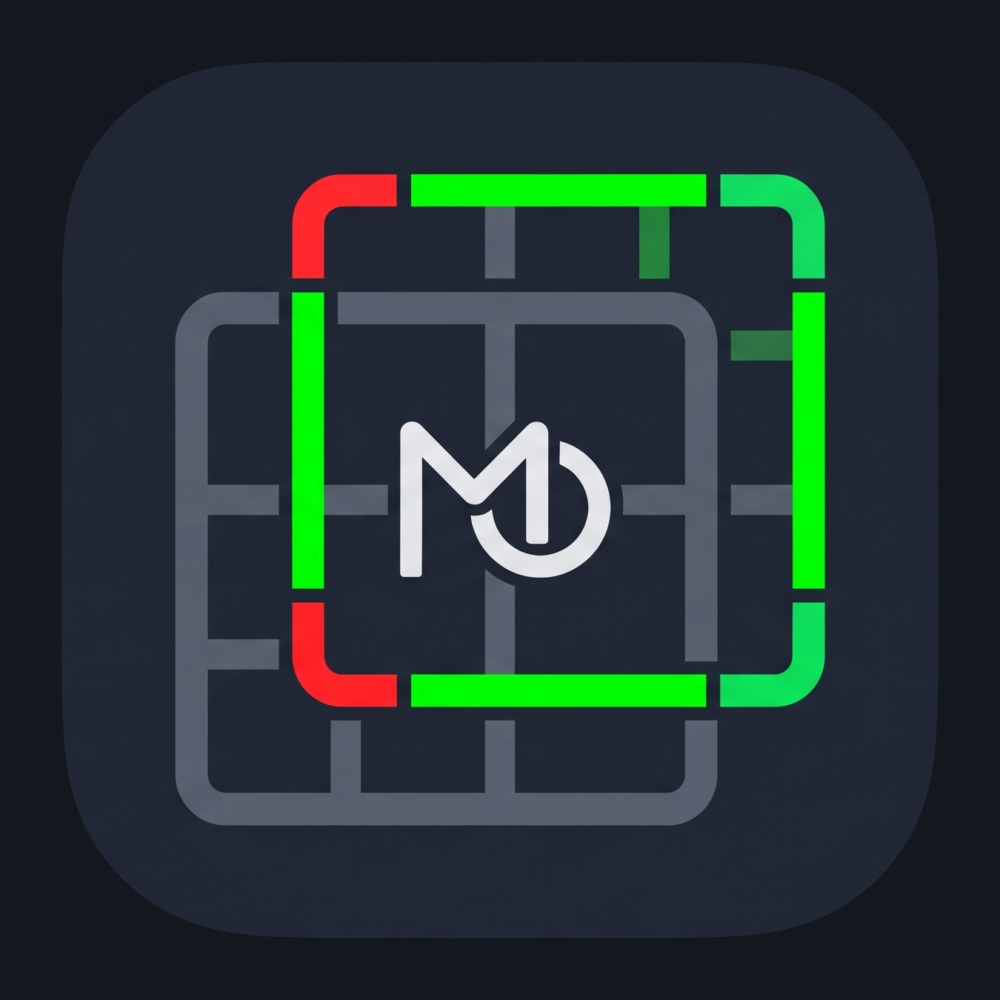

# ATEM Multiview Overlay (MVO)

<p align="center">
  
</p>

<p align="center">
  <strong>Broadcast Feed Augmentation, Dynamic Tally & Key/Fill Generator for Blackmagic Design ATEM Switchers</strong>
</p>

<p align="center">
  <a href="LICENSE"></a>
  <a href="https://nodejs.org/"></a>
  <a href="https://www.typescriptlang.org/"></a>
  
  
</p>

---

> [!WARNING]
> **AI Development Disclaimer:** This project contains AI-assisted code. It was designed, architected, and built with the assistance of an advanced AI coding agent. If an AI-assisted project does not align with your preferences or workflow requirements, you are welcome to review, fork, or modify the source code. This project is 100% open-source under the [MIT License](LICENSE).

---

## Overview

Blackmagic Design ATEM live production switchers feature a fixed number of Multiview outputs. In modern hybrid productions, media servers and multi-head PCs frequently capture clean, borderless, and unlabelled Multiview feeds (allowing operators to crop individual camera feeds into Zoom, Teams, vMix, or LED processors). 

However, disabling Multiview borders and labels leaves the switcher operator and director blind to critical production metadata: **camera tallies (Program/Preview)**, **source labels**, and **quadrant divisions**.

**ATEM Multiview Overlay (MVO)** resolves this challenge. By connecting directly to any ATEM switcher over local network UDP, MVO mirrors the switcher's active Multiview layout and real-time tally states, generating a pixel-accurate HTML5 graphical overlay with <16ms latency. This overlay can be keyed back over clean multiview video via:
1. **Key & Fill (SDI/NDI)**: Dedicated Fill (`/out`) and Key Alpha Matte (`/key`) outputs for downstream video mixers.
2. **Alpha Key / Transparent (`/out`)**: Zero-opacity browser source capture in OBS Studio, vMix, or Wirecast.
3. **Chroma Key (`/out`)**: Solid green, blue, or magenta background keying.

---

## Key Features

### Broadcast Keying Modes
* **Key & Fill Dual-Channel Output (`/out` Fill + `/key` Key)**:
  * **Fill Output (`/out`)**: Rendered over a solid black (`#000000`) background with full-color tally borders and crisp source label boxes.
  * **Key Alpha Matte (`/key`)**: Pixel-aligned grayscale luminance matte (100% white `#FFFFFF` for opaque borders and text; 65% white `rgba(255,255,255,0.65)` for translucent label box backgrounds).
  * **Safety Guard Overlay**: Automatic warning screen displayed on `/key` whenever the application is not operating in Key & Fill mode to prevent accidental on-air keying mistakes.
* **Alpha Key / Transparent Mode (`/out`)**: Completely transparent background (`transparent`), designed for OBS Studio and vMix Browser Sources with zero color fringing.
* **Chroma Key Mode (`/out`)**: Solid background color with instant presets (`#00FF00` Green, `#0000FF` Blue, `#FF00FF` Magenta) and custom hex input. Includes chroma-safe dark label backgrounds to prevent green chroma spill from eating into text boxes.

### ATEM State Synchronization
* **Accurate 4x4 Row-Major Layout Engine**: Faithfully parses the ATEM 4-bit quadrant bitmask (`0` through `15`), supporting:
  * **4 Large Quadrants** (Layout `0`)
  * **Program Top 10-View** (Layout `12`)
  * **Program Bottom 10-View** (Layout `3`)
  * **Full 16-Grid** (Layout `15`)
  * **Asymmetric side splits** (Layouts `5`, `10`, etc.)
* **Dynamic Switcher Capability Discovery**: Automatically queries connected ATEM hardware to discover active Multiviewers (`MV 1` through `MV 4`) and M/E stages, dynamically displaying custom M/E labels (e.g., `M/E 1 (PGM)`, `M/E 4 (ME GAME)`).
* **Live Program & Preview Tally Tracking**: Real-time border updates reflecting on-air cuts, preview selections, DSKs, and SuperSources with dual-state priority highlighting.
* **ATEM Native Visual Typography**: Re-creates the native Blackmagic Multiview look and feel (`#161418` dark box fill, `#96929a` subtle grey stroke, `2.1vh` font size, `2.5vh` bottom margin, preserving native casing).
* **Fail-Safe Mid-Show Resilience**: Caches and retains last-known grid geometry during ATEM reboots or network interruptions so client displays never flash white or drop borders mid-production.

### Operator Dashboard & Workflow Tools
* **Studio Monitor Live Confidence Preview**: Integrated 16:9 viewport with real-time mirroring and a dedicated 1-click **Fill (`/out`)** / **Key (`/key`)** preview switcher.
* **Active Window Routing Inspector**: Live tabular view displaying Window index, grid placement, Input ID, source name, live tally badges, and individual per-window "Hide Label" toggles (ideal for suppressing labels over audio meters, HyperDecks, or streaming clocks).
* **Auto Light / Dark Theme Engine**: Studio-grade dark theme (inspired by broadcast master control interfaces) with a 3-state switcher (`Auto (OS)`, `Dark`, `Light`) that synchronizes with your operating system preference.
* **Offline Simulation Mode**: Comprehensive switcher simulator allowing broadcast engineers to pre-visualize layouts, test camera cuts, and verify keying without physical ATEM hardware connected.

---

## Directory Structure

```text
mv_injector/
├── package.json
├── tsconfig.json
├── config.json                     # Persistent configuration state
├── LICENSE                         # MIT License
├── README.md                       # Project documentation
├── src/
│   ├── server.ts                   # Express & Socket.io server entry point
│   ├── atemManager.ts              # ATEM connection manager & state parser
│   ├── configManager.ts            # Persistent configuration manager
│   └── types.ts                    # Shared TypeScript interfaces
└── public/
    ├── index.html                  # Control Panel dashboard
    ├── out.html                    # Headless Output / Fill view (/out)
    ├── key.html                    # Key / Alpha Matte output view (/key)
    ├── media/
    │   ├── logo_icon.png           # App icon (MVO squircle)
    │   ├── favicon.png             # Browser favicon
    │   └── personal_logo.webp      # Author logo
    ├── css/
    │   ├── control.css             # Control Panel & theme styling
    │   └── overlay.css             # 16:9 pixel-accurate grid & tally styling
    └── js/
        ├── control.js              # Control Panel logic & preview controller
        └── overlay.js              # Overlay rendering engine (/out and /key)
```

---

## Installation & Quick Start

### 1. Requirements
* **Node.js**: v18.0.0+ LTS (Node.js v20+ recommended)
* **Package Manager**: npm or pnpm
* **Network**: Direct Ethernet/LAN access to your Blackmagic ATEM switcher (UDP port 9910)

### 2. Install Dependencies
```bash
npm install
```

### 3. Build & Run
To run in development mode with live file watching:
```bash
npm run dev
```

To build and run the production server:
```bash
npm run build
npm start
```

Default HTTP endpoints:
* **Control Panel Dashboard**: [http://localhost:3000/](http://localhost:3000/)
* **Fill / Output View**: [http://localhost:3000/out](http://localhost:3000/out)
* **Key / Alpha Matte View**: [http://localhost:3000/key](http://localhost:3000/key)

---

## Operation & Workflow Guide

### 1. Connecting to an ATEM Switcher
1. Open [http://localhost:3000/](http://localhost:3000/) in your browser.
2. Enter your ATEM switcher's IP address (e.g., `192.168.10.240`) into the **ATEM IP Address** field and click **Connect / Apply**.
3. Select your **Target Multiviewer** (`MV 1`–`MV 4`) and **Tally M/E Source** from the dynamic dropdowns.
4. Settings are automatically saved to `config.json` and persist across server restarts.

### 2. OBS Studio / vMix Setup (Transparent Alpha Key)
1. In the Control Panel, set **Keying Type** to **Alpha Key (Transparent for OBS / vMix)**.
2. In OBS Studio, add a **Browser Source**:
   * **URL:** `http://<server-ip>:3000/out`
   * **Width:** `1920` (or `3840` for 4K)
   * **Height:** `1080` (or `2160` for 4K)
   * Check **Shutdown source when not visible** (optional).
3. Position the Browser Source directly on top of your clean multiview capture feed.

### 3. Key & Fill Broadcast Setup (External Switcher / Media Server)
1. In the Control Panel, set **Keying Type** to **Key & Fill (/out Fill + /key Key)**.
2. Route the two URLs to your media server or dual-display outputs:
   * **Fill Feed:** `http://<server-ip>:3000/out`
   * **Key Feed:** `http://<server-ip>:3000/key`
3. On your downstream production switcher (ATEM, Ross, TriCaster, vMix):
   * Set **Key Type** to **Linear / Luma Key**.
   * Assign the Fill channel to `/out` and the Key channel to `/key`.
   * Uncheck *Pre-multiplied* (or adjust Clip & Gain to taste). The label boxes will key as semi-transparent dark glass with 100% solid borders and text!

### 4. Downstream Chroma Key Setup
1. In the Control Panel, set **Keying Type** to **Chroma Key (Solid Color)**.
2. Select your desired background color (Green `#00FF00`, Blue `#0000FF`, or Magenta `#FF00FF`).
3. Set your **Preview Tally Color** to **Amber (`#FFAA00`)** or **Cyan (`#00FFFF`)** to avoid chroma keyer spill eating into green preview tally borders.

### 5. Offline Simulation Mode
When working without physical hardware:
1. Click **Simulation Mode** in the top navigation bar.
2. Test different Multiview quadrant splits using the layout preset buttons (`4 Large Quad`, `10-View`, `16-Grid`).
3. Trigger virtual camera tally transitions using the **Cam 1–4 PVW** and **Cam 1–4 PGM** buttons.

---

## Technical Specifications

| Parameter | Specification |
| :--- | :--- |
| **Backend Runtime** | Node.js (v18+ LTS) |
| **Language** | TypeScript (Strict mode) |
| **Communication** | WebSocket (`socket.io`) & REST API |
| **Local Latency** | < 16ms (sub-frame broadcast responsiveness) |
| **Hardware Protocol** | `atem-connection` (Direct UDP port 9910) |
| **Frontend Framework** | Zero framework overhead (Vanilla HTML5, CSS Grid, ES6 JavaScript) |
| **Grid Math** | 4x4 Master Matrix CSS Grid with inward `box-sizing: border-box` |
| **Aspect Ratio** | Fixed 16:9 (1080p / 4K responsive via `vh`/`vw` scaling) |

---

## Author & Credits

* **Developed by:** Timotius Austin ([Linktree](https://linktr.ee/timotiusaustin43))
* **ATEM Protocol Library:** Powered by the open-source [`atem-connection`](https://github.com/nrkno/tv-automation-atem-connection) library by Sofie / NRK.

---

## Legal & Trademarks

> **Disclaimer:** This project is an independent, open-source software application. It is **not** affiliated with, endorsed by, sponsored by, or associated with **Blackmagic Design Pty. Ltd.**
>
> "Blackmagic Design", "ATEM", and "ATEM Constellation" are registered trademarks of Blackmagic Design Pty. Ltd.

---

## License

This project is licensed under the **MIT License**. See the [LICENSE](LICENSE) file for details.
